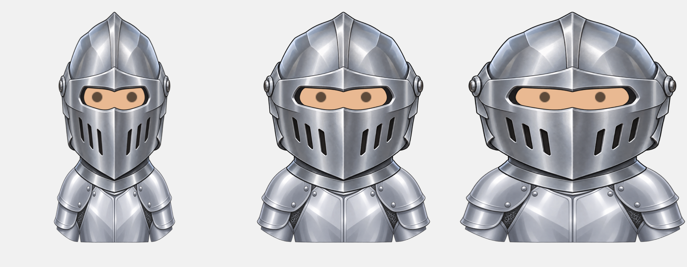

# Knight helmet artwork

`KnightHelmet` is accessory (`Addition`) raw value **48**, appended after `WitchHat`. Both editors use the existing accessory catalog. It keeps its original silver colors and replaces visible hair without changing the saved hairstyle or hair color.

The closed visor hides the mouth, nose, and facial hair. Its layer covers glasses outside the transparent eye opening. Removing the helmet restores these features. The UIKit editor and bitmap renderer use the same visibility and layer ordering.

## Asset and placement

- Generated master: `Scripts/Artwork/KnightHelmet-source.png`.
- Asset catalog: `Sources/Avatar/Avatar.xcassets/Top/KnightHelmet.imageset`.
- Canvas: 266 x 280 points, exported at 1x/2x/3x.
- Artwork frame: x=40, y=13, width=186, height=211.
- Import: `swift Scripts/import-knight-helmet.swift` from the package root.
- Cropping removes only transparent margins; resizing preserves generated alpha and original colors. The existing body-width transform also scales the helmet.



This is an AppKit artwork placement proof using the original skin silhouette, eyes, armor, and XIB layer coordinates at 0.70, 1.00, and 1.30 body widths. It is not an app screenshot and does not reproduce procedural body shading.

## Provenance and prompts

Created with the built-in `image_gen.imagegen` tool. Original generation: `exec-f6845acd-fc91-4b1b-97a1-d5be79dd9c1c.png`. Final edited master: `exec-d288000d-979c-4986-a6cf-bd295b2bdd1d.png`. See the repository's [artwork licensing status](../LICENSING.md).

### Generation

```text
Use case: stylized-concept. Asset type: transparent layered avatar headwear sprite for a polished 2.5D mobile game. Create ONE medieval knight's closed steel helmet, straight-on symmetrical FRONT view, isolated and centered, fully visible. Silver-gray polished steel plates with crisp thin dark outlines, soft faceted highlights, small side hinge rivets, gently peaked rounded crown, subtle central ridge and a closed angular lower visor with a few dark inset ventilation slits. Match a clean friendly mobile-game silver plate armor illustration, not photorealistic. Wide, slightly squat head proportions, helmet outer width about 85% of its height. CRITICAL eye aperture: ONE broad continuous horizontal opening, actually transparent alpha, no face, eyes, nose, head or hair drawn. Opening spans 12% to 88% of helmet width and 38% to 55% of helmet height, enough to show an avatar's two eyes behind it. No central bar across eye opening. Solid metal faceplate below the eye opening covers nose, mouth and chin. Short neck rim, no shoulders, no body. No plume, horns, weapons, emblems, letters or extra objects. Entire background and eye aperture genuinely transparent alpha=0. Only physical helmet remains, antialiased edge, no glow, halo, cast shadow, backdrop or checkerboard texture. Small transparent margin around object.
```

### Eye-opening fit

```text
Use case: precise-object-edit. Edit this transparent knight helmet game sprite. Change ONLY the eye aperture width. The current opening is too wide for the avatar face. Keep the entire outer helmet shape, every plate, crown, lower visor, rivets, vents, silver colors, shading, texture, height, margins and transparent background exactly the same. Extend the silver metal side cheeks and dark inner rim inward equally from both sides, narrowing the transparent eye aperture by approximately 25% in total; its widest transparent part must span only 58% to 60% of the helmet outer width. Retain the current opening height and vertical location, and keep one continuous broad horizontal eye opening with no central bar. Keep the middle top/bottom contours unchanged. Use natural rounded end edges where the aperture is narrowed. The eye hole must remain actually alpha=0 transparent. No face or eyes, no background, no glow, no other modifications.
```

